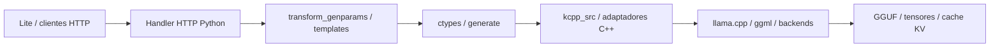

# Arquitetura observada do KoboldCpp

`init_library` carrega bibliotecas nativas e configura assinaturas: [koboldcpp.py:970](https://github.com/LostRuins/koboldcpp/blob/6d2fedf8624e5f05926af3191f9efdcb13c4133c/koboldcpp.py#L970).
`load_model` preenche parâmetros de memória, contexto, KV e aceleração:
[koboldcpp.py:2172](https://github.com/LostRuins/koboldcpp/blob/6d2fedf8624e5f05926af3191f9efdcb13c4133c/koboldcpp.py#L2172). `generate` converte parâmetros para estrutura nativa,
aplica limites e coleta resultados: [koboldcpp.py:2333](https://github.com/LostRuins/koboldcpp/blob/6d2fedf8624e5f05926af3191f9efdcb13c4133c/koboldcpp.py#L2333).

`KcppServerRequestHandler` é o núcleo HTTP: [koboldcpp.py:6053](https://github.com/LostRuins/koboldcpp/blob/6d2fedf8624e5f05926af3191f9efdcb13c4133c/koboldcpp.py#L6053).
`transform_genparams` traduz formatos externos; `format_jinja` renderiza mensagens.
O handler produz streaming enquanto a inferência ocorre fora do loop assíncrono,
e pode separar `reasoning_content`. Consulte o inventário detalhado no relatório principal.

A integração llama.cpp está no próprio checkout, não é chamada como serviço externo:
`kcpp_src/gpttype_adapter.cpp` usa `llama_model_load_from_file`, `llama_init_from_model`
e `llama_decode` (linhas 3790,3900,9081). O Central conserva esta separação e
trata o executável como um processo independente, sem linkar bibliotecas do motor.

O backend oferece múltiplos caminhos de execução e capacidades. Não podemos deduzir
quais estão disponíveis no binário anexado sem inspecioná-lo ou executar um binário
confiável em sistema adequado. A lista de arquiteturas em `src/llama-arch.cpp`
é evidência de registro, não teste de um arquivo GGUF específico.
